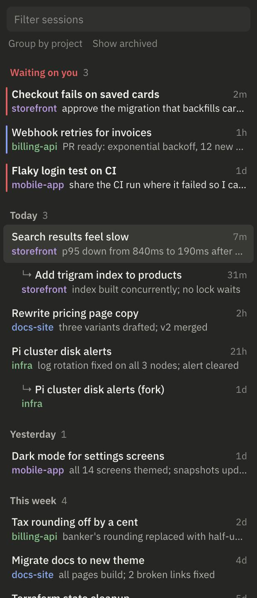
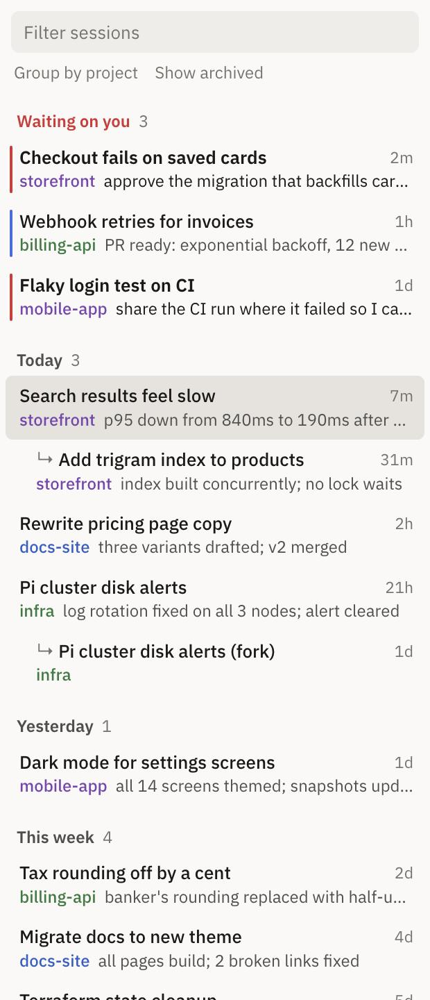

# claude-recent

A live recent-sessions panel for the Claude desktop app's Code tab on macOS.

It docks to the right of the Claude window, lists every Code session by when you last worked in it, and switches the app to a session when you click it. The list updates itself every 5 seconds as sessions start, finish or get stuck.

<table>
  <tr>
    <td></td>
    <td></td>
  </tr>
</table>

## What it shows

- **Waiting on you.** Sessions from the past week that are blocked on you or ready for review sit at the top. A red bar marks blocked sessions, a blue bar marks ones ready for review.
- **Where each session stands.** The app's own one-line summary appears under each title, like "approve the migration that backfills card fingerprints".
- **Time groups or projects.** Sessions fall under Today, Yesterday, This week and so on, or under their project folder. Each project keeps its own color.
- **Session families.** Spawned sessions and forks sit indented under the session they came from.
- **Where you are.** The last session you opened from the panel stays highlighted.

## Install

You need macOS, the Claude desktop app, Python 3 (already on most Macs) and [Hammerspoon](https://www.hammerspoon.org).

1. Clone the repo.

   ```bash
   git clone https://github.com/L422Y/claude-recent.git ~/claude-recent
   ```

2. Install Hammerspoon.

   ```bash
   brew install --cask hammerspoon
   ```

3. Link the panel script into Hammerspoon's config folder.

   ```bash
   mkdir -p ~/.hammerspoon && ln -s ~/claude-recent/hammerspoon/claude-recent.lua ~/.hammerspoon/claude-recent.lua
   ```

4. Load it from Hammerspoon's config.

   ```bash
   echo 'recent = require("claude-recent")' >> ~/.hammerspoon/init.lua
   ```

5. Open Hammerspoon and allow it in System Settings → Privacy & Security → Accessibility. Then quit Hammerspoon and open it again. It only picks up the permission on a fresh start.

6. Optional: turn on "Launch Hammerspoon at login" in Hammerspoon's preferences so the panel comes back after a reboot.

Hammerspoon starts the panel's local server for you. Keep the cloned folder where it is, because the link in step 3 points into it.

## Controls

| To | Do this |
| --- | --- |
| Open a session | Click its row, or arrow to it and press Enter |
| Filter | Type in the box at the top, or press `/` to jump there |
| Resize | Drag the panel's left edge. Claude resizes to fill the rest of the screen. Resizing Claude works the other way too. |
| Hide or show the panel | `ctrl+alt+R` |
| Group by project instead of time | Click "Group by project" |
| Include archived sessions | Click "Show archived" |

The panel floats beside Claude while Claude is the front app and drops behind other apps when you switch away. It remembers its width and both toggles.

## Without Hammerspoon

Start the server yourself and open http://127.0.0.1:7799 in any browser. You get the same list in a tab instead of a docked panel.

```bash
python3 ~/claude-recent/recent.py
```

## Try it with demo data

The screenshots use made-up sessions. To see them, run the demo and open http://127.0.0.1:7798.

```bash
python3 ~/claude-recent/recent.py --demo
```

## How it works

- The desktop app keeps a JSON file for each Code session in `~/Library/Application Support/Claude/claude-code-sessions`.
- `recent.py` reads those files and serves the list on `127.0.0.1:7799`. The page asks it for fresh data every 5 seconds.
- Clicking a row runs `open claude://claude.ai/epitaxy/<session id>`, the link the app uses for its own sessions. The server only accepts that request from its own page, so other websites can't trigger it.
- The Hammerspoon script shows the page in a floating window. Claude's window doesn't report being resized, so the script checks both windows four times a second and moves whichever one didn't change. That's why it needs Accessibility access.

## Limits

- The session files are the app's internal format, not a public interface. An app update can change them, and the list may come up empty until this project catches up.
- It can't archive sessions. The app's archive action isn't reachable from outside the app.
- Only the main Claude window docks. Pop-out session windows are left alone.
- The page loads IBM Plex Sans from Google Fonts. Offline, it falls back to the system font.

## Uninstall

1. Remove the link.

   ```bash
   rm ~/.hammerspoon/claude-recent.lua
   ```

2. Delete the `recent = require("claude-recent")` line from `~/.hammerspoon/init.lua`.
3. Delete the `~/claude-recent` folder.

## License

MIT
